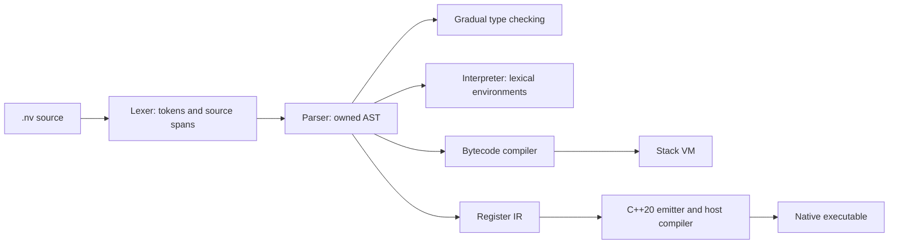

# Implemented architecture

NextViper is experimental C++20 software. The lexer and parser produce an AST. Execution currently follows one of three paths:

1. `run` or `run --tree`: a tree-walk interpreter evaluates the AST using environments and tagged values.
2. `run --vm`: the bytecode compiler emits an in-memory chunk consumed by the stack VM. Persistent bytecode serialization/loading is unfinished.
3. `build` or `compile`: AST visitors produce register IR; a C++20 emitter generates a standalone program with a tagged runtime; a host C++ compiler produces the executable.

The native backend is not LLVM-based and does not implement JIT compilation. Its runtime uses dynamic tags and reference-counted collections/closure cells. Reference counting does not collect cycles. Functions can retain their parsed declarations or captured cells; lifetime and resource behavior still need broader testing.

Optional-looking libraries currently have mandatory build dependencies: Vulkan and PostgreSQL development libraries. HTTP clients invoke external curl with a separate argument vector. DataFrame, tensor, autograd and database implementations are local components rather than automatic interoperability with PyTorch, ONNX, CUDA or other libraries.

Static checking is gradual and incomplete. The interpreter, VM and native backend do not have a proven universal equivalence contract. See [CURRENT_STATUS.md](CURRENT_STATUS.md) for tested scope and limitations, and [HARDENING.md](HARDENING.md) for the targeted corrections.

For `print(1 + 2)`, the lexer emits the identifier, parentheses, integer literals,
and `+`; the parser constructs a call containing a binary expression. The
interpreter evaluates it directly; the VM emits constants, addition and a call;
the native route emits tagged-value operations and compiles them. All three must
print `3` followed by a newline. `tests/test_language_contract.py` checks shared
observable behavior and explicitly selects backends for subset features.

List/string slice normalization is shared in `include/nextviper/slicing.hpp` by
the interpreter and VM. Native slicing is unsupported and must be diagnosed.
